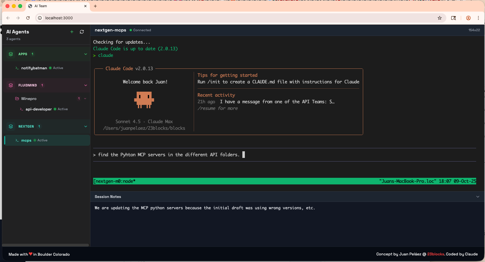
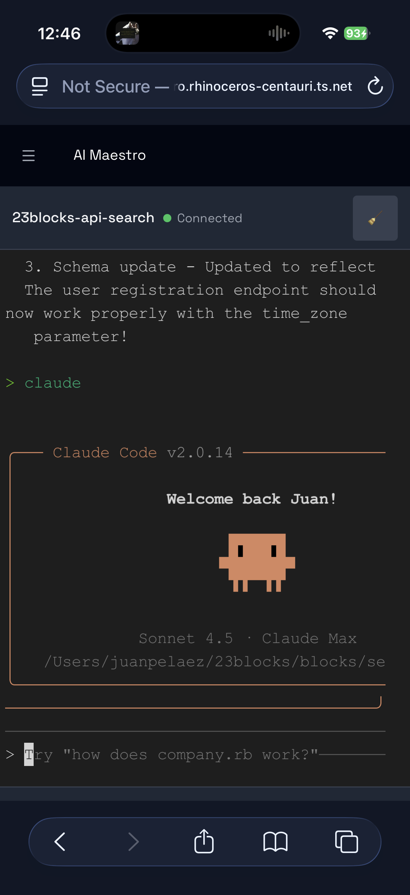
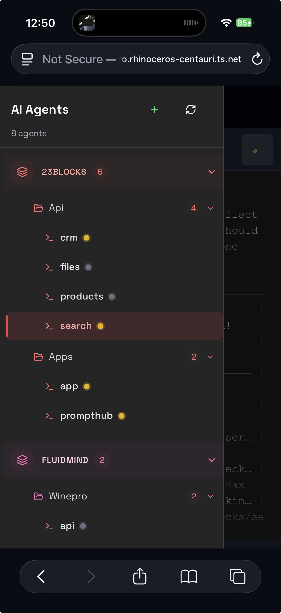
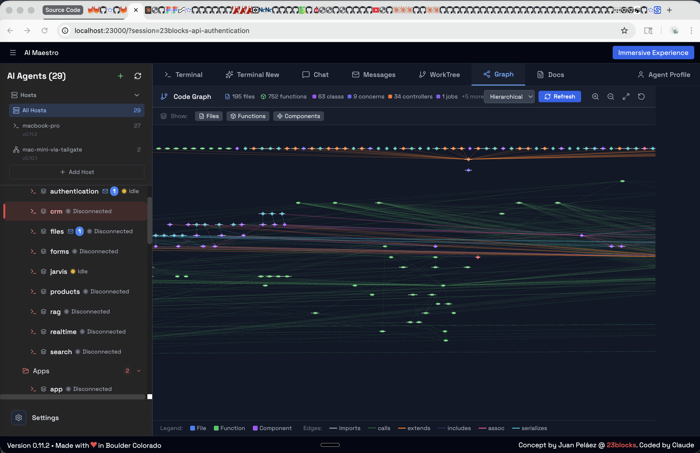
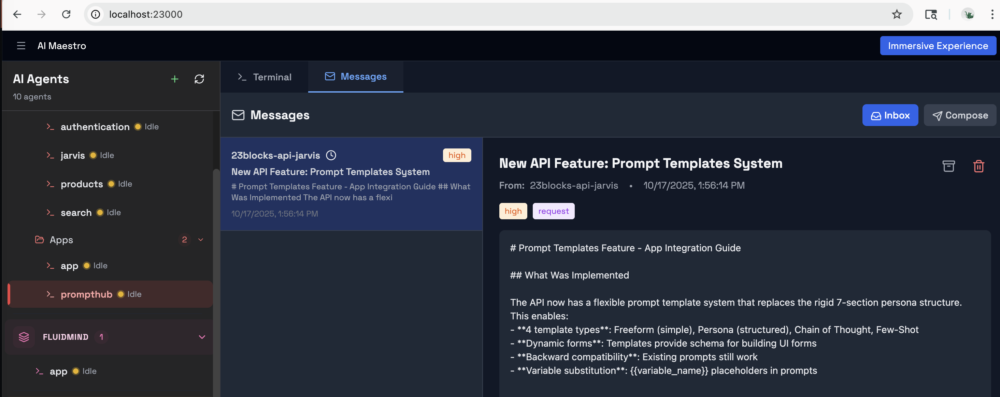

<div align="center">


# AI Maestro

*I was running 35 AI agents across multiple terminals and became the human mailman between them. So I built AI Maestro.*

**The OS for AI-first organizations — orchestrate any AI agent with persistent memory, agent-to-agent messaging, and multi-machine support.**

[](https://github.com/23blocks-OS/ai-maestro/releases)
[-lightgrey)](https://github.com/23blocks-OS/ai-maestro)
[](./LICENSE)
[](https://github.com/23blocks-OS/ai-maestro)



[Quick Start](#quick-start) · [Features](#features) · [Skills](#skills) · [Protocols](#protocols) · [Documentation](#documentation) · [Contributing](./CONTRIBUTING.md)

</div>

---

## The Story

I gave an AI agent a real task — not autocomplete, a real engineering problem. It checked the code, read the logs, queried the database, and came back with the answer. That was the moment. *This thing can actually work.*

Within a week I was running 35 agents across terminals. They were productive, but they couldn't talk to each other. I became the human message bus — copying context from one terminal, pasting into another. I was the bottleneck in my own AI team.

**So I built AI Maestro** — one dashboard to see every agent, on every machine, with persistent memory and direct agent-to-agent communication. Today I run 80+ agents across multiple computers, building real companies with them every day.

**What makes this different:**
- **Works with the agents you already use** — Claude Code, Codex and Grok Build get launch, chat history, status and approval cards. Pi, OpenClaw and GitHub Copilot CLI launch from AI Maestro and run in the terminal tab, as does any other terminal agent. [What each one supports](./docs/AGENT-PROGRAMS.md). We don't lock you in.
- **Multi-machine from day one** — Peer mesh network with no central server. Nobody else does this.
- **Agents that communicate** — The Agent Messaging Protocol (AMP) lets agents coordinate directly. You orchestrate, they collaborate.
- **Yours, entirely** — MIT licensed. No account, no telemetry, no per-seat pricing, no hosted tier we upsell you to. Your code and your agents stay on your machines.

---

## The Mental Model

**AI Maestro is an operating system for an AI-first company.** Not a task runner — a place where a standing team works.

An agent here is closer to an **employee** than to a job. It has a name, a face, a memory that survives the session, an inbox — and it **owns** something: a product, a repository, a process, a customer. Its memory and code graph are indexed against what it owns, which is why it gets better at that thing over months rather than starting cold every morning.

Because agents own things, **they don't share a working copy.** Two agents that need the same repository each clone it, work on their own branch, and integrate through git — push, pull request, review, merge — exactly like two engineers on a team.

That's deliberate, and it follows from the one thing that defines this product: **your agents run on different machines.** A shared checkout needs a shared filesystem. Git worktrees — the isolation primitive the single-machine agent IDEs are built on — are several working directories over **one `.git` store on one disk**, so they stop working the moment your backend agent is on a Linux box and your iOS agent is on a Mac. A clone is the only primitive that survives the move. It's why transferring an agent to another host clones its repos to the destination: an agent's repositories travel with the agent.

[The full model →](./docs/CONCEPTS.md#agent-ownership)

---

## Quick Start

```bash
curl -fsSL https://raw.githubusercontent.com/23blocks-OS/ai-maestro/main/scripts/remote-install.sh | sh
```

This installs everything you need:
- AI Maestro dashboard and service
- Agent messaging system (AMP)
- The AI Maestro plugin for Claude Code: [13 skills](#skills) and their CLI scripts, plus the `aim-secret` and `safe-psql` helpers

**Time:** 5-10 minutes · **Requires:** Node.js 18+, tmux · *Optional:* Claude Code 2.1.287+ for the [inbox mod](docs/CLAUDE-CODE-MODS.md)

<details>
<summary>Windows (WSL2) / Linux notes</summary>

**Windows:** Install WSL2 first (PowerShell as Administrator, then restart), then open **Ubuntu** from the Start menu and run the curl command there:

```powershell
wsl --install
```

New to WSL? WSL is a Linux system with its own disk, so its home folder starts empty. Keep agents there (`~/agents/<name>`, the default), not in `C:\` folders, which are much slower from WSL. Open their files from Windows at `\\wsl.localhost\Ubuntu\home\<you>\agents`. [Windows in 5 minutes](./docs/WINDOWS-INSTALLATION.md#windows-in-5-minutes-read-this-first) · [Full Windows guide](./docs/WINDOWS-INSTALLATION.md)

**Linux:** Ensure build tools are installed: `sudo apt install tmux build-essential`
</details>

<details>
<summary>Manual install</summary>

```bash
git clone https://github.com/23blocks-OS/ai-maestro.git
cd ai-maestro
yarn install
yarn dev
```

See [QUICKSTART.md](./docs/QUICKSTART.md) for detailed setup options.
</details>

Dashboard opens at `http://localhost:23000`

**Update** an existing install from its folder (pulls, updates submodules, builds, reinstalls hooks and the plugin, restarts):

```bash
./update-aimaestro.sh -y
```

**Come back to it** without remembering the address: the installer adds an `ai-maestro` command (`ai-maestro open` starts the server if it is down, then opens the dashboard; also `start`, `stop`, `status`) and, on a Mac, an **AI Maestro** app in `~/Applications` you can drag to the Dock. It can also start at login. Chrome and Edge offer "Install app" from the dashboard too. Skip all of it with `--skip-launcher`; remove it with `./scripts/install-launcher.sh --remove`.

---

## Features

Every feature was born from running a real AI-first organization. We built them in the order we needed them.

### One Dashboard

*I had 35 terminals and couldn't tell which was which.*

See and manage all your AI agents in one place. Create agents from the UI with a guided wizard, organize them with smart naming (`project-backend-api` becomes a 3-level tree with auto-coloring), and switch between any agent with a click. Four deployment modes: **tmux** (local), **Docker** (containerized), **AWS EC2** (dedicated instance), and **AWS ECS Fargate** (serverless). Auto-discovers tmux sessions, Docker containers, cloud deployments, and standalone agents.

### Any Machine

*My Mac Mini was sitting there idle. What if I ran agents on that too?*

A peer mesh network where every machine is equal. Add a computer, it joins the mesh. Every agent on every machine, visible from one dashboard. Use each machine for what it's best at — Mac for iOS builds, Linux for Docker, cloud for heavy compute. **No central server required.**

Worker machines can run headless (`yarn headless`) — the full API and agent runtime with no UI, in about 100MB of RAM. Run the dashboard where you sit; run agents wherever the compute is.

### Agent Messaging

*I was the mailman — copying messages between agents because they couldn't talk to each other.*

The [Agent Messaging Protocol (AMP)](https://agentmessaging.org) gives your agents email-like communication. Priority levels, message types, cryptographic signatures, and push notifications. Tell your agent *"send a message to backend about the deployment"* — it just works. Agents coordinate directly while you manage the big picture.

**Before AMP:** You copy research from one terminal, paste into another, repeat 50 times a day.
**With AMP:** *"Research agent, send your findings to the writing agent."* Done.

### Gateways

*A friend in Singapore wanted his agents to talk to mine. But I didn't want to give him access to my network.*

Connect your AI agents to [Slack](https://github.com/23blocks-OS/aimaestro-gateways), Discord, Email, and WhatsApp through organizational gateways. Smart routing (`@AIM:agent-name`), thread-aware responses, and content security with 34 prompt injection patterns detected at the gateway — before any agent sees the message.

### Persistent Memory

*Every morning, my agents woke up with amnesia.*

**Long-term memory** is a skill you switch on per agent. Every night each agent's conversations become memory: short statements of what it learned, each backed by the passages it came from, and an **entity graph** of the things it works with and how they relate (`runs on`, `depends on`, `stores data in`, `deploys to`), kept current, with ended relations marked. Claude Code deletes transcripts after 30 days; AI Maestro rebuilds that history from the agent's own message index, so months of work become memory instead of disappearing. When a prompt names something, the agent is told what it relates to before it acts, so it can see what a change affects. Knowledge that comes up in more sessions weighs more; secrets are redacted and never stored. [How it works →](docs/LONG-TERM-MEMORY.md)

Alongside it: **Code Graph** (interactive visualization of your entire codebase with delta indexing) and **Documentation** (auto-generated, searchable docs from your code). Agents get smarter the longer they work with you.

### Chat

*I wanted to answer an agent's question without finding its terminal.*

Talk to an agent in a chat view, on desktop or on your phone. When the agent asks a question or needs an approval, it shows up as a card you can click, and the click sends the same key you would press in the terminal. Claude Code, Codex and Grok Build all work here. [How the chat works →](docs/CHAT-ARCHITECTURE.md)

### Secrets

*I kept pasting API keys into chats, and the model kept seeing them.*

Agents use a credential without seeing it. `aim-secret` keeps values in a local vault (macOS Keychain, Linux libsecret, or an encrypted file). An agent asks for a secret by name; a card in the chat, with a masked field, lets you store it; the agent then runs commands that use it by name, with the value scrubbed from the output. In Claude Code, the `ai-maestro-secrets` mod asks through a form in the terminal instead. Scrubbing stops accidents, not an agent that wants the value, so use narrowly scoped keys. [Secrets →](docs/SECRETS.md) · [Claude Code mods →](docs/CLAUDE-CODE-MODS.md)

### Work Coordination

*Talking isn't working. I needed agents to coordinate on actual deliverables.*

Assemble agents into teams, run meetings in split-pane war rooms, and track tasks on a full Kanban board with drag-and-drop, dependencies, and 5 status columns. Cross-machine teams work seamlessly. This is project management for your AI workforce.

### Claude Code Mods

*A Claude Code session with no tmux has nowhere for a message to land.*

Mods are plugins that run inside Claude Code 2.1.287 or later. AI Maestro ships two: an **inbox mod** that shows unread agent messages in the status line and above the prompt, and a **secrets mod** that lets an agent request a credential. AI Maestro itself works with any current Claude Code version. [Details and limits →](docs/CLAUDE-CODE-MODS.md)

### Canvas

*Sometimes the answer is a form, a chart or an approval, not a paragraph.*

Agents draw interactive HTML pages in the dashboard, and what you click or submit comes back to them as a structured action ([AAP](#protocols)). [Agent actions →](https://ai-maestro.23blocks.com/agent-actions.html)

### Scheduled Work

*Some jobs shouldn't wait for me to remember to ask.*

Give an agent its own schedule — morning triage, a nightly dependency check, a Monday report. The timer belongs to the **agent, not the machine**, so a schedule travels with the agent when it moves hosts, and fires when that agent goes idle instead of interrupting it mid-task.

### Agent Presence

*At 80 agents, they all looked the same.*

Custom avatars, personality profiles, and roles for every agent. When an agent has a face and a job title, you instinctively assign it the right work — just like a real team.

Agents can also **speak and be seen**: a voice pipeline with your choice of TTS provider, and live animated faces that move while the agent talks. Open a call with an agent and it looks back at you. Nobody else is doing this, and once you've reviewed a plan by listening to it on a walk, the terminal feels like a downgrade.

One caveat worth stating plainly: **true lip-sync — mouth movement driven by the actual audio — needs the OpenAI or ElevenLabs voice and an API key.** The default browser voice (`web-speech`) renders straight to your speakers and exposes no audio stream to measure, so the face animates from a synthetic envelope instead. It looks alive; it is not tracking the words. That is a limit of the Web Speech API, not something we plan to work around.

### Agent Deployment

*One agent on my laptop. Another on EC2. A third on Fargate. All in the same dashboard.*

Four ways to run agents, each for a different need:

| Mode | What | Best For |
|------|------|----------|
| **tmux** | Direct terminal sessions on your machine | Local development, zero setup |
| **Docker** | Containerized agents with resource limits | Isolation, reproducibility, multi-project |
| **AWS EC2** | Dedicated Graviton instance with native install, Nginx + SSL | Always-on agents, SSH access, persistent workloads |
| **AWS ECS Fargate** | Serverless containers, auto-built Docker image | Burst scaling, zero maintenance, pay-per-use |

Cloud agents are Terraform-managed. EC2 installs Node.js, tmux, and AI CLIs directly on ARM64 hardware (no Docker overhead). ECS auto-builds your Docker image, pushes to ECR, and runs on Fargate. Both deploy with one command from the dashboard or CLI.

```bash
# EC2: dedicated instance with SSL
aimaestro-agent.sh create my-api --ec2 \
  --domain api.example.com --ssl-email admin@example.com --key-name my-key

# ECS Fargate: serverless (auto-builds image)
aimaestro-agent.sh create worker --ecs
```

---

## Meet Lola — Your First Hire

Every AI-first organization starts with one agent. **Lola** is yours — a batteries-included Chief of Staff framework built for AI Maestro. She handles email triage, semantic memory, task management, and content security out of the box. Install the platform, deploy Lola, and you have your first employee on day one.

```bash
# Clone and deploy Lola on AI Maestro
git clone https://github.com/23blocks-OS/lolabot.git
cd lolabot && ./setup.sh
```

**The LolaBot Ecosystem:**
- **[LolaBot Framework](https://github.com/23blocks-OS/lolabot)** — Open-source agent framework. Build your own Lola.
- **[lolabots.com](https://lolabots.com)** — The LolaBot Factory. Pre-built agent templates, one-click deploy.

[Learn more about Lola →](https://github.com/23blocks-OS/lolabot)

---

## The Agent Ecosystem

Every agent is built from five dimensions:

| | Dimension | What | Where |
|-|-----------|------|-------|
| **WHO** | Personality | Domain expertise, workflows, deliverables | [Agent Library](https://github.com/msitarzewski/agency-agents) (150+) |
| **HOW** | Capabilities | Skills, scripts, CLI tools, Canvas | [Plugin Builder](https://github.com/23blocks-OS/ai-maestro-plugins) |
| **TRUST** | Identity | Cryptographic keys, OAuth tokens | [AID](https://agentids.org) |
| **TALK** | Communication | Agent-to-agent messaging | [AMP](https://agentmessaging.org) |
| **ACT** | Actions | Clicks and forms from agent-drawn pages | [AAP](https://agentactions.org) |

See [Skills](#skills) and [Protocols](#protocols) below.

AI Maestro is the stage. Pick personalities, give them skills, and run them from one dashboard.

[Read the full ecosystem guide →](./docs/ECOSYSTEM.md)

---

## Skills

The AI Maestro plugin (version 1.7.3) carries 13 skills in the open [Agent Skills Standard](https://agentskills.io/specification) format. An agent loads a skill when its description matches the task.

| Skill | What it does | Source |
|---|---|---|
| `memory-search` | Search what the agent learned in past sessions, and what depends on an entity | [plugin builder](https://github.com/23blocks-OS/ai-maestro-plugins) |
| `docs-search` | Look up signatures and APIs in the generated docs | [plugin builder](https://github.com/23blocks-OS/ai-maestro-plugins) |
| `graph-query` | Callers, dependencies and blast radius from the code graph | [plugin builder](https://github.com/23blocks-OS/ai-maestro-plugins) |
| `ai-maestro-agents-management` | Create, rename, hibernate, wake and delete agents | [plugin builder](https://github.com/23blocks-OS/ai-maestro-plugins) |
| `planning` | Persistent plan, findings and progress files for long tasks | [plugin builder](https://github.com/23blocks-OS/ai-maestro-plugins) |
| `aim-secret-management` | Use a credential without seeing it; ask the user to store one | [plugin builder](https://github.com/23blocks-OS/ai-maestro-plugins) |
| `agent-messaging` | Signed messages between agents (AMP) | [agentmessaging/claude-plugin](https://github.com/agentmessaging/claude-plugin) |
| `agent-identity` | Sign in with an Ed25519 identity and OAuth 2.0 tokens (AID) | [agentmessaging/agent-identity](https://github.com/agentmessaging/agent-identity) |
| `canvas-actions` | Interactive pages in the dashboard and their actions (AAP) | [agentmessaging/agent-actions](https://github.com/agentmessaging/agent-actions) |
| `agent-files` | Share files across hosts through an AFP space | [agentmessaging/agent-files](https://github.com/agentmessaging/agent-files) |
| `agentic-sql` | Read-only SQL against real databases through `safe-psql`; changes data only through `safe-psql-write`, after a person approves each change | [23blocks-OS/agentic-sql](https://github.com/23blocks-OS/agentic-sql) |
| `agentic-support` | Numbered support cases with a written trail, and runbooks | [23blocks-OS/agentic-support](https://github.com/23blocks-OS/agentic-support) |
| `agentic-seo` | SEO audit and implementation for websites | [23blocks-OS/agentic-seo](https://github.com/23blocks-OS/agentic-seo) |

The installer and updater set up the helpers the skills need (`aim-secret`, `safe-psql`). To add only the plugin to Claude Code:

```
/plugin marketplace add 23blocks-OS/ai-maestro-plugins
/plugin install ai-maestro@ai-maestro-plugins
```

Pick your own set with the [plugin builder](./plugin/README.md). More on the [skills page](https://ai-maestro.23blocks.com/skills.html); how we keep them good is in [SKILLS-QUALITY.md](./docs/SKILLS-QUALITY.md).

---

## Protocols

AI Maestro implements four open protocols, all under [github.com/agentmessaging](https://github.com/agentmessaging). Each works without the others.

| Protocol | Covers | Specification |
|---|---|---|
| **AMP** — Agent Messaging Protocol | Signed messages between agents, local or federated | [agentmessaging.org](https://agentmessaging.org) |
| **AID** — Agent Identity | Ed25519 agent identity and OAuth 2.0 tokens | [agentids.org](https://agentids.org) |
| **AAP** — Agent Actions Protocol | Actions from agent-drawn pages back to the agent | [agentactions.org](https://agentactions.org) |
| **AFP** — Agent Files Protocol | Files shared by reference through S3-compatible storage | [agentmessaging/agent-files](https://github.com/agentmessaging/agent-files) |

[Protocols page](https://ai-maestro.23blocks.com/protocols.html) · [AID, AMP and AAP mapped onto the Poppy draft](./docs/AID-POPPY-MAPPING.md) (a design note, nothing implemented) · [AMP outbox design](./docs/AMP-OUTBOX-DESIGN.md) (a proposal, not built)

---

## Who Is This For

**Founders building AI-first organizations.** You're the CEO, your agents are the team. Solo operators, agency owners, and anyone running a business where AI agents do the work and you drive the strategy. Start with Lola, add specialists, scale your AI workforce.

**Developers running multiple AI agents.** If you have 3+ agents and you're switching between terminals, losing context, and playing messenger — this is for you. Works with Claude Code, Codex, Grok Build, or any terminal-based AI.

**Teams coordinating AI-assisted work.** Multiple developers, multiple agents, multiple machines. One dashboard. Agent-to-agent messaging replaces you as the bottleneck.

**Creators and operators** who want to connect AI agents to the outside world through Slack, Discord, or Email — without exposing their infrastructure.

---

<details>
<summary><b>Screenshots</b></summary>

<div align="center">


</div>

**Code Graph** — Interactive codebase visualization



**Agent Inbox** — Direct agent-to-agent messaging



</details>

---

## Documentation

**New here?**
- [Quick Start Guide](./docs/QUICKSTART.md) — Get up and running
- [Core Concepts](./docs/CONCEPTS.md) — Understand how it works
- [Use Cases](./docs/USE-CASES.md) — Real examples of what people build

**Going deeper:**
- [Multi-Machine Setup](./docs/SETUP-TUTORIAL.md) · [Network Access](./docs/NETWORK-ACCESS.md)
- [Cloud Deployment (AWS)](./docs/cloud-aws.html) · [Docker Agents](./docs/docker-local.html)
- [Agent Messaging Guide](./docs/AGENT-MESSAGING-GUIDE.md) · [Architecture](./docs/AGENT-COMMUNICATION-ARCHITECTURE.md)
- [Chat Architecture](./docs/CHAT-ARCHITECTURE.md) — how messages reach an agent, and how questions come back
- [Intelligence Guide](./docs/AGENT-INTELLIGENCE.md) · [Code Graph](./docs/images/code_graph01.png) · [Long-term memory](./docs/LONG-TERM-MEMORY.md)
- [Secrets](./docs/SECRETS.md) — agents use a credential without seeing it
- [Claude Code mods](./docs/CLAUDE-CODE-MODS.md) — inbox and secrets mods, and Claude Code versions
- [Agent programs](./docs/AGENT-PROGRAMS.md) — what Claude Code, Codex and Grok Build each support
- [Operations Guide](./docs/OPERATIONS-GUIDE.md)

**Troubleshooting:**
- [Common Issues](./docs/TROUBLESHOOTING.md) · [Security](./SECURITY.md) · [Windows Installation](./docs/WINDOWS-INSTALLATION.md)

**Open Protocols:**
- [AMP](https://agentmessaging.org) · [AID](https://agentids.org) · [AAP](https://agentactions.org) · [AFP](https://github.com/agentmessaging/agent-files)
- Design notes: [AID, AMP and AAP on the Poppy draft](./docs/AID-POPPY-MAPPING.md) · [AMP outbox (proposal)](./docs/AMP-OUTBOX-DESIGN.md)

**Extending:**
- [Plugin Development](./plugin/README.md) · [API Reference](./docs/AGENT-COMMUNICATION-ARCHITECTURE.md) · [Ecosystem Guide](./docs/ECOSYSTEM.md)

---

## What's Next

- **Create an agent from a repo URL** — clone and staff it in one step, instead of cloning by hand and pointing an agent at the folder
- Agent search and filtering across the entire mesh
- Agent playback — time-travel through agent sessions
- Performance analytics dashboard

See the full [roadmap](https://github.com/23blocks-OS/ai-maestro/issues).

---

## Contributing

We love contributions. See [CONTRIBUTING.md](./CONTRIBUTING.md) for guidelines.

- [Report a bug](https://github.com/23blocks-OS/ai-maestro/issues)
- [Request a feature](https://github.com/23blocks-OS/ai-maestro/issues/new?labels=enhancement)

### Contributors

AI Maestro is better because of people outside the team who hit something, read
the source, and sent a fix. In order of arrival:

- **[@Emasoft](https://github.com/Emasoft)** — a consolidated fix across memory,
  terminal, installers, skills and the API covering 65+ issues, plus CI repairs
  for the installer workflow and the agent-cli skill check. The single largest
  outside contribution to this project.
- **[@dwzrd86](https://github.com/dwzrd86)** (Darius Davis) — Ubuntu 24.04 support
  and crash resilience, and the Phase 5 work behind the Search, Export and
  Playback tabs: hooks, UI scaffolding, and the integration into the main page.
- **[@Tanariel](https://github.com/Tanariel)** — `C-m` instead of `Enter` for tmux
  `send-keys`, which is still how every message reaches an agent today, and a fix
  stopping undefined values from overwriting task fields on update.
- **[@meichuanyi](https://github.com/meichuanyi)** — the FAQ section, which is the
  first thing many people read.
- **[@weliu](https://github.com/weliu)** (Wenfeng Liu) — corrected the pm2 start
  command to use `ecosystem.config.js`.
- **[@nodoyuna](https://github.com/nodoyuna)** (Javier Moya, [jaak.ai](https://jaak.ai))
  — found that the installer reported success over an install that could not
  start, traced it to an early return that made the existing repair unreachable,
  and sent a tested fix ([#453](https://github.com/23blocks-OS/ai-maestro/pull/453)).

[Full list on GitHub →](https://github.com/23blocks-OS/ai-maestro/graphs/contributors)

We built this because one of us was running 35 agents across terminals and had
become the human message bus between them. It solved our problem. That it solves
yours too is the best thing that has happened to this project — and a patch from
someone who hit a rough edge and read the source is the most useful thing we can
receive. [Open a PR](./CONTRIBUTING.md).

<details>
<summary><b>Acknowledgments</b></summary>

Built with [Next.js](https://nextjs.org/), [xterm.js](https://xtermjs.org/), [CozoDB](https://www.cozodb.org/), [ts-morph](https://ts-morph.com/), [tmux](https://github.com/tmux/tmux), and [Claude Code](https://claude.ai).

</details>

---

## License

MIT — see [LICENSE](./LICENSE). Free for any purpose, including commercial.

---

<div align="center">

**Made with love in Boulder (USA), Roma (Italy), and many other cool places**

[Juan Pelaez](https://x.com/jkpelaez) · [23blocks](https://23blocks.com)

*Built by AI Agents with Humans in the driver seat — for AI-first organizations, AI-enabled humans, and autonomous agents*

[Star us on GitHub](https://github.com/23blocks-OS/ai-maestro)

</div>

## FAQ

**Do I need to use Claude Code?**
No. Claude Code, Codex and Grok Build get first-class support (launch, chat, status, approval cards), and any other terminal agent runs in the terminal tab. See [what each one supports](./docs/AGENT-PROGRAMS.md).

**Does it work on Linux / Windows?**
Yes. macOS and Linux natively. Windows via WSL2 — see the [Windows guide](./docs/WINDOWS-INSTALLATION.md).

**Can agents on different machines talk to each other?**
Yes. The [Agent Messaging Protocol (AMP)](https://agentmessaging.org) handles cross-machine messaging with cryptographic signatures and push notifications. No central server required.

**What are AID, AAP and AFP?**
[AID](https://agentids.org) (Agent Identity) gives each agent a portable cryptographic identity. [AAP](https://agentactions.org) (Agent Actions Protocol) carries a click or form submit from an agent-drawn page back to the agent. [AFP](https://github.com/agentmessaging/agent-files) (Agent Files Protocol) shares files across hosts by reference. Together with [AMP](https://agentmessaging.org), they are the open protocols AI Maestro implements. See [Protocols](#protocols).

**What is the Canvas skill?**
The `canvas-actions` skill lets an agent draw interactive HTML pages (dashboards, charts, forms, approvals) in the AI Maestro dashboard and handle what you click or submit. It ships in the plugin.

**How is this different from just using tmux?**
tmux gives you terminals. AI Maestro gives you an organization — persistent memory, agent-to-agent messaging, team coordination, Kanban boards, multi-machine mesh, cloud deployment, and gateway integrations. tmux is the foundation; AI Maestro is the building.

**What is LolaBot?**
[LolaBot](https://github.com/23blocks-OS/lolabot) is an open-source agent framework — a batteries-included Chief of Staff that handles email, memory, tasks, and security. The [LolaBot Factory](https://lolabots.com) offers pre-built agent templates for one-click deployment.

**What does it cost?**
Nothing. MIT licensed, free for any purpose including commercial — no seats, no usage fees, no paid tier. You bring your own agent subscriptions (Claude Code, Codex, Grok Build, whatever you already pay for) and AI Maestro just runs them. Note that some tools in this space are *source-available* rather than open source, under licenses that forbid offering them as a service; MIT has no such restriction.

**Do you collect telemetry?**
No. No analytics SDK, no account, no login, no phone-home. The only telemetry in the product is the agent metrics shown on your own dashboard, and those post to `localhost:23000` — your machine. Point them at a central collector only if you choose to run one.

**How does this compare to the parallel-agent IDEs?**
Different job, and deliberately so. Tools like Orca, Paseo, Superset and Conductor run several agents on **one repository on one machine**, each in an isolated git worktree, then diff the results so you can merge the best one. It's a disposable fan-out: five attempts at the same task, keep one, throw away four. They're good at it. If that's the workflow you want today, use one of them.

AI Maestro is built for the case after that one — a **standing team** of agents that own things, remember their work, message each other, and run across every machine you have. We don't use worktrees because worktrees can't leave the machine they're on: they're several working directories over one `.git` store on one disk. Our agents each clone what they own and integrate through pull requests, like a human team, which is the only model that works when the backend agent is on Linux and the iOS agent is on a Mac. See [the mental model](#the-mental-model).

**Can I run several agents on the same repository?**
Yes — give each one its own clone. Backend owns the API, frontend owns the web app, infra owns the Terraform, even inside a monorepo. They coordinate over AMP and merge through git. For a large repo, `git clone --filter=blob:none` or `--reference` to a local mirror keeps the disk cost down. And an individual agent is free to use `git worktree` inside its own clone — worktrees are a fine tool *within* an agent, just not how we isolate agents *from each other*.

**Is there a hosted / cloud version?**
Not yet. AI Maestro runs on your machines. You own your data, your agents, and your infrastructure.

**How do I add more agents?**
Create them from the dashboard UI, the CLI (`aimaestro-agent.sh create`), or just start a new tmux session — AI Maestro auto-discovers it.
