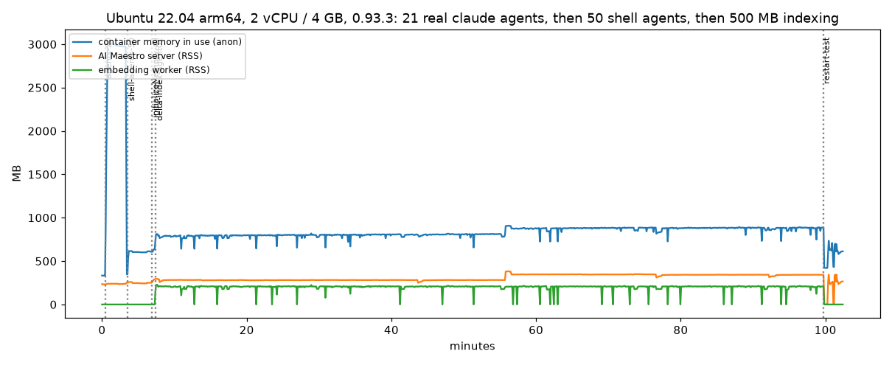
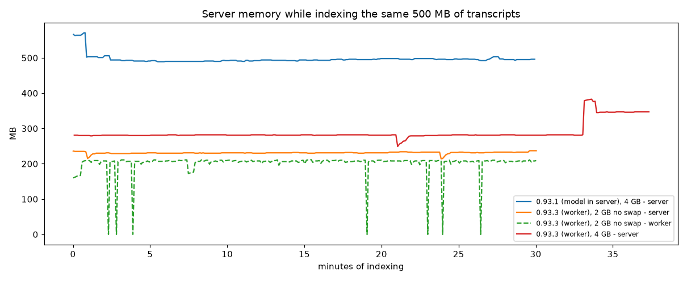
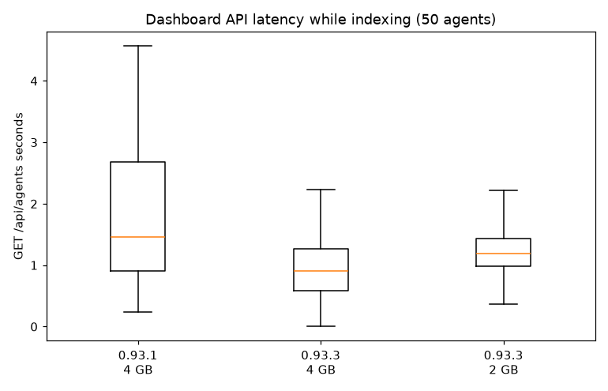

# Running AI Maestro on a Linux VM: sizing, install and what we measured

This page is for anyone putting AI Maestro on a cloud VM (a small company, a managed host, a
Lola installation) instead of a Mac. It says what machine to ask for, what the installer does,
how much memory and disk each part uses, and how those numbers were measured, including what was
**not** measured.

Everything below was measured on 2026-10-21 with 0.93.3 in Linux containers that stand in for a
VM (Ubuntu 22.04). Treat the numbers as a floor for planning, not as a promise: the agents in the
test were idle, and the host was a fast Apple Silicon Mac, not a cloud VM. See
[What was not measured](#what-was-not-measured).

## Short answer

| | Minimum | Comfortable |
|---|---|---|
| **RAM** | **4 GB**, or 2 GB **plus swap** (the build needs it, see below) | 4 GB + about 0.25 GB for every Claude Code agent you expect to run at once |
| **vCPU** | 2 | 2-4 (indexing a large history uses about two cores while it runs) |
| **Disk** | 15 GB | 25 GB + about 6 KB for every indexed message (about 5 GB for 500 MB of transcripts) |
| **Network** | outbound to GitHub (install, the `cozo-node` binary) and Hugging Face (the 34 MB embedding model, first use) | |
| **Supervisor** | pm2 (the installer sets it up) or systemd | |

- **Installing is what needs the memory, not running.** At 2 GB with no swap the build is killed.
  Once built, the AI Maestro server idles at about 235 MB and stays at 250-380 MB while indexing.
- **The agents are the memory cost, not AI Maestro.** An idle `claude` process costs about 130 MB
  (200 MB RSS) each. A working agent will use more; that was not measured.
- **Indexing a big history is slow:** about 6 messages a second, one agent at a time. 500 MB of
  transcripts takes about 40 hours. It runs in the background; the dashboard stays usable, but
  slower while it runs.

## Install

```bash
curl -fsSL https://raw.githubusercontent.com/23blocks-OS/ai-maestro/main/scripts/remote-install.sh | bash -s -- -y
```

It installs Node 20 (nvm), yarn, **pm2**, tmux, jq and build tools, clones AI Maestro, builds it,
starts it under pm2 and creates a first agent.

### Memory needed to install (0.93.4 and later check this for you)

| Machine | Result of `yarn build` | Time |
|---|---|---|
| 4 GB, no swap (arm64) | builds | install about 4 minutes in total |
| 4 GB, amd64 under emulation | builds | install 470 s |
| **2 GB, no swap** | **killed** ("Killed", exit 137) at "Linting and checking validity of types" | |
| 2 GB + 4 GB swap | builds, `yarn build` alone took 68 s; 1.5 GB of real memory peak, 218 MB of swap used | |

Before 0.93.4 the 2 GB failure said only "Check the output above". The installer and
`update-aimaestro.sh` now check RAM + swap first and stop with the fix when it is below about
2.5 GB; between 2.5 and 3.5 GB they warn. If a build is killed anyway (exit 137), they say it was
the memory. To add swap (needs sudo; a temporary file):

```bash
sudo fallocate -l 4G /swapfile && sudo chmod 600 /swapfile && sudo mkswap /swapfile && sudo swapon /swapfile
# remove it later:  sudo swapoff /swapfile && sudo rm /swapfile
```

A container cannot add swap: raise its memory limit. In a container the check reads the cgroup
limit, not the host RAM that `/proc/meminfo` shows. To skip the check (you know the build fits, or
it is already built): `AIMAESTRO_SKIP_MEMORY_CHECK=1`.

### Keeping it running (0.93.4 and later)

Before 0.93.4 the Linux install started a bare `yarn start` unless pm2 already existed. After
`kill -9` of the server (what an out-of-memory kill looks like) it did not come back; tmux sessions
survived, so agents kept running while nothing served the dashboard. Now the installer installs
pm2 and starts AI Maestro with `ecosystem.config.js`. Measured with pm2 on Linux: after `kill -9` of
the server it was back in about 12 seconds, with no orphan embedding worker; pm2's own daemon costs
about 54 MB.

To survive a reboot, run once (the installer prints the exact line for your machine; it never runs
sudo for you):

```bash
pm2 startup        # prints a "sudo env PATH=... pm2 startup systemd ..." line: run it
pm2 save
```

systemd works too; any supervisor that restarts `yarn start` (or `pm2 start ecosystem.config.js
--env production`) is fine.

### Leftovers on the disk

| Item | Size |
|---|---|
| The app (`~/ai-maestro`: node_modules 1.6 GB, `.next` 457 MB) | 2.6 GB |
| nvm and Node | 450 MB |
| **yarn's download cache** (`~/.cache/yarn`) | **6.3 GB**, reclaimable: `yarn cache clean` |

The installer tells you how big the cache is. It does not delete it: it is your yarn cache, shared
with other projects.

## What it uses once running

### Memory, 0.93.3, 2 vCPU / 4 GB

| State | AI Maestro server (RSS) | Container memory in use |
|---|---|---|
| After boot, one agent running `claude` | 233-236 MB | 333 MB |
| 21 real `claude` agents at their login prompt | 236 MB | 2,975 MB (about 132 MB each; 200 MB RSS each) |
| 50 plain shell agents | 243 MB | 601 MB (about 5 MB each) |

`GET /api/agents` with 51 agents answers in 0.11-0.17 s. An idle server answers in 13 ms (p50).



### Indexing 500 MB of transcripts

The load was synthetic: 200 Claude Code transcripts (501 MB, about 4,200 messages each, for 50
agents) plus 10 Copilot sessions. "Memory init" is `initializeMemory` for every agent; the rest is
the server's own background indexing.

| | 0.93.3, 4 GB | 0.93.1, 4 GB (before the changes below) | 0.93.3, **2 GB, no swap** |
|---|---|---|---|
| Memory init for 51 agents | 24 s | 42 s | 138 s (the page cache could not hold the 500 MB) |
| Server RSS while indexing | 249-383 MB (about 340 MB after 40 min) | **489-571 MB** | 214-237 MB |
| Embedding worker RSS | up to 224 MB | none (the model ran in the server) | up to 212 MB |
| Peak memory in use | 908 MB | 918 MB | 675 MB |
| Dashboard API while indexing | p50 0.92 s, p99 2.2 s, max 4.1 s | p50 1.45 s, p99 4.7 s, max 5.9 s | p50 1.19 s, p99 2.3 s, max 2.8 s |
| Speed | 16,923 messages in 48 min = **5.8 msg/s** | about 6.7 msg/s (from the batch log) | no agent finished in 30 min |
| Out-of-memory kills at runtime | 0 | 0 | 0 |





**What Camilo Caceres' change did on Linux.** 0.93.2 and 0.93.3 contain
[Camilo Caceres'](https://github.com/CamiloCaceres) work (#612, #613): transcripts are read as a
stream instead of whole files, and the embedding model runs in a separate, bounded worker process
instead of inside the server. On Linux, with 50 agents and 500 MB of transcripts, the server uses
about 200 MB less while indexing (about 340 MB against 490-570 MB) and its slowest dashboard calls
last about half as long (p99 2.2 s against 4.7 s). Speed is about the same, maybe 15% lower (5.8
against 6.7 messages a second; the 0.93.1 figure is from its batch log, so it is approximate). On
the Mac the same change measured about twice as slow; on a 2-vCPU Linux box the difference is small.
The worker retires after 64 batches (15 times in 77 minutes) and reloads from the cache each time.

**While it indexes the dashboard is slower.** About 6 messages a second means 500 MB of transcripts
(about 850,000 messages) take about 40 hours, one agent at a time; calls to the API take about a
second instead of 10 ms while it runs.

### Long indexing runs no longer time out (0.93.4)

`POST /api/agents/:id/index-delta` used to hold the request open until indexing finished. The server
closes a connection that is idle for 15 minutes, so a long run was cut off (curl got status 000)
while indexing carried on, and the caller never saw the result. It is now a job: the call waits up
to `waitSeconds` (default 60, at most 600) and answers **200** with the result if it finished, or
**202** with `{"running": true, "startedAt": ...}` if not. The run carries on in the background; a
second call for the same agent joins it instead of starting another. Ask how it is doing with:

```bash
curl localhost:23000/api/agents/<agent-id>/index-delta     # {"state":"running"|"done"|"failed"|"none", ...}
```

`dryRun=true` is answered directly, as before. The state is kept in memory: after a server restart
it reads `none` until the next run. A first `index-delta` on a brand-new agent returns "Schema not
initialized yet" and does nothing until the agent's memory is initialised.

### Disk growth

One fully indexed agent (16,923 messages) takes 101 MB in `~/.aimaestro`: **about 6 KB per indexed
message** (a 384-number vector plus the text). A full index of the 500 MB test load would be roughly
5 GB. The server log was 417 KB after 100 minutes of indexing. Real transcripts differ from the
synthetic ones (long tool outputs, different message sizes): measure on your own before trusting
the ratio.

### Soak

77 minutes of continuous indexing. Server RSS rose from about 281 MB (first 10 minutes) to about
346 MB (40-50 minutes) and stayed there (340 MB in the last 10 minutes), with one step of +100 MB at
minute 56 and back. That looks like warm-up. A straight-line fit gives +69 MB an hour, which includes
the warm-up. 77 minutes cannot rule out a slow leak.

## Capacity planning for a managed deployment

A worksheet for sizing one VM per company. The inputs are yours; the constants come from the
measurements above and are **floors**, so keep the margin.

```
RAM (GB)  =  1.0                      # OS + AI Maestro server (0.4) + embedding worker (0.25, only while indexing) + pm2 + headroom
          +  0.25 x claude_agents     # measured idle: 0.13 real / 0.20 RSS; leave room for working agents
          +  0.005 x shell_agents     # tmux + shell, measured 5 MB each
          then at least 4 GB (or 2 GB + swap) so the build and updates fit

Disk (GB) =  OS image (not measured)
          +  3.0                      # app + nvm, after `yarn cache clean`  (6.3 more until you do)
          +  0.006 x (indexed_messages / 1000)   # 6 KB per indexed message
          +  logs and the agents' own work (yours to estimate)

Indexing time (h) = indexed_messages / 6 / 3600     # one agent at a time, about 5.8-6.7 messages a second on 2 vCPU

vCPU      =  2 (4 if agents work hard while a large history is being indexed; indexing fills about two cores)
```

Example (illustrative): a company with 10 Claude agents, each adding 5,000 messages a month:
RAM 1.0 + 2.5 = 3.5, so a 4 GB machine; the index grows 50,000 x 6 KB = about 300 MB a month and
takes about 2.3 hours of indexing a month. Importing an existing 500 MB history is a one-off of
about 40 hours and 5 GB, so do it before the agents are busy, or on the weekend.

| Agents (Claude, concurrently) | RAM from the formula | Suggested VM |
|---|---|---|
| up to 5 | 2.3 GB | 4 GB, 2 vCPU, 25 GB |
| up to 15 | 4.8 GB | 8 GB, 2-4 vCPU, 25 GB + index growth |
| up to 30 | 8.5 GB | 16 GB, 4 vCPU, 40 GB + index growth |

These sizes come from the formula, **not** from runs at those agent counts. Per company, watch
`pm2 monit` (or `docker stats`) for a week and adjust; a working Claude agent uses more than an idle one.

## How this was tested

- **Host:** an Apple Silicon Mac (16 CPUs, 16 GB) running Docker (OrbStack). Not a cloud VM: its disk
  is fast NVMe and there are no noisy neighbours.
- **Image:** `ubuntu:22.04`, user with sudo, curl and git only. AI Maestro was installed by its own
  installer (`remote-install.sh -y`), as in the README. Nothing was baked in.
- **Containers:** A, 0.93.3 at 2 vCPU / 4 GB (the main run, 77 minutes of continuous indexing, 102
  minutes in all); B, 0.93.1 at 4 GB (the same load, 30 minutes, for the before/after); C, 0.93.3 at
  2 GB with no swap (30 minutes, the failure test) plus a 2 GB + 4 GB swap build; D, amd64 under
  Rosetta emulation, 4 GB (install and startup only). arm64 was native.
- **Load:** 50 agents registered with the same API call the installer uses, with a plain shell and a
  light loop in each tmux session; 21 real `claude` processes (unauthenticated, at the login prompt;
  no credentials were involved) for the per-agent figure; 200 synthetic Claude Code transcripts
  (501 MB) and 10 Copilot sessions for indexing.
- **Measurement:** every 5 seconds, from outside: the container's cgroup memory (`anon`, total with
  page cache, peak, swap, out-of-memory kills) and the RSS of each process; one probe a second of
  `GET /api/agents` and `GET /api/sessions` for latency. "Memory in use" means the `anon` figure
  (the page cache is excluded).
- **Restart tests:** `kill -9` of the server with and without pm2.
- Nothing touched a real system: containers named `aim-linux-*`, no mounts of any real home,
  synthetic data only.

## What was not measured

- **Real working Claude agents.** The agents were idle (a login prompt) or shell loops. A busy agent
  with a real conversation uses more memory; the per-agent figures are a floor.
- **A real cloud VM.** Disk speed, network latency and noisy neighbours are not modelled. The 2 GB
  run's slower memory init (138 s) is page-cache pressure on this host and may differ on a cloud disk.
- **amd64 timing.** The amd64 run used emulation: install and startup work and the worker loads, but
  a 1 MB indexing run did not finish in 15 minutes, so emulated timing means nothing.
- **A longer soak:** 77 minutes, not hours or days.
- **Other distributions** (Debian, Amazon Linux), `yarn dev`, headless mode, systemd units, IPv6.
- **inotify limits:** the test host allows 1,048,576 watches; many VMs default to 8,192.
- **The worker's memory-based retirement** (at 512 MB, using plain RSS on Linux, since there is no
  `vmmap`): it never triggered; only the batch-count retirement (64 batches) was exercised.
- **Other hosts' versions:** 0.93.3 only, plus 0.93.1 for the comparison.

## Notes for operators

- `node-pty` has no Linux prebuilt binary, so it compiles on the VM (make and a C++ compiler; the
  installer installs them). `cozo-node` downloads its binary at install: the VM needs outbound access
  to GitHub. `onnxruntime-node` ships arm64 and x64.
- `~/.local/bin` must be on `PATH` for the agent commands (`aimaestro-task.sh`, `amp-send.sh`...).
  `verify-installation.sh` tells you, and now prints the line to add to `~/.bashrc`.
- The first agent the installer creates starts `claude`, which then waits for a login: log in once on
  the VM (`claude`, then `/login`) or give it a token.
